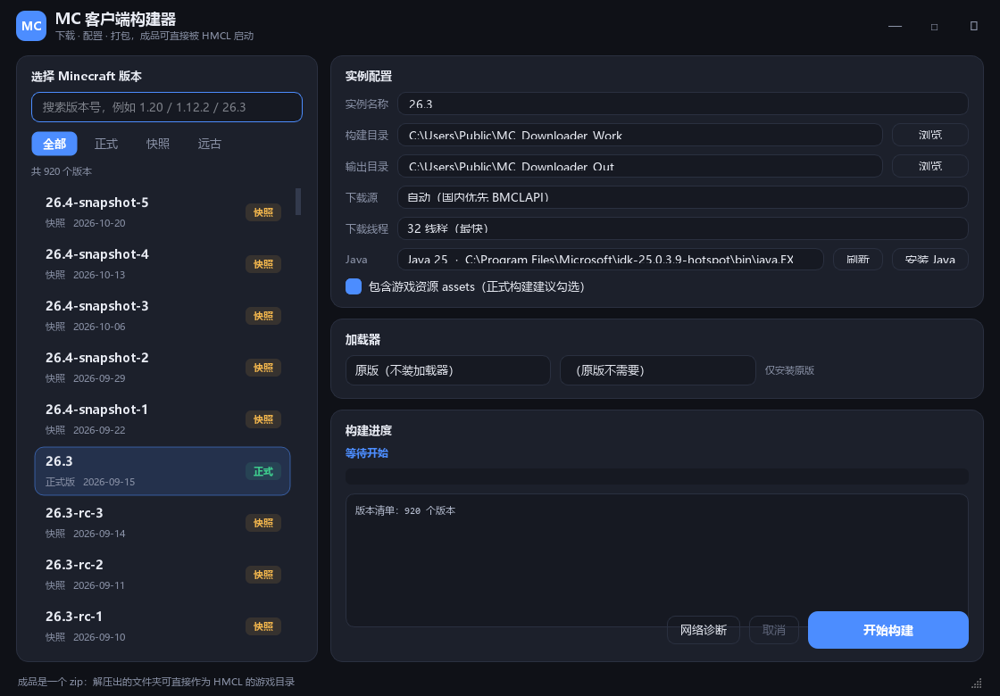

# MC 客户端构建器

> 一个不依赖启动器的 Minecraft 客户端下载 / 配置 / 打包工具。
> 选好版本和加载器，自动下载原版、依赖库、资源文件，调用官方安装器装好 Forge / OptiFine / Fabric / Quilt，最后打包成一个可以直接被 HMCL 启动的 zip。



## 功能

- **全量版本**：正式版、快照、远古 Alpha / Beta（约 900+ 个版本）
- **原版安装**：version JSON、client jar、libraries、assets、logging 全套
- **加载器**
  - Forge：调用官方 installer 的 `--installClient`，1.12.2 和新版本都支持
  - OptiFine：调用官方 `optifine.Patcher` 生成补丁库
  - Fabric / Quilt：读取官方 meta 直接生成版本 JSON
- **安装 Java**：Mojang 官方运行时（8 / 16 / 17 / 21 / 25），装好自动加入列表
- **下载源**：自动（国内优先 BMCLAPI）/ 仅 BMCLAPI / 仅 Mojang 官方，失败自动换源
- **下载线程**：4 / 8 / 16 / 24 / 32 可选，默认 32
- **完整性**：SHA-1 校验、按哈希缓存、原子写入、可取消
- **离线兜底**：内置版本清单，清单接口不可用时仍能显示版本列表
- **网络诊断**：DNS / TCP / HTTPS / 代理 / 系统时间一键检查

## 系统要求

- Windows 10 / 11 **64 位**
- 源码运行需要 Python 3.10+（推荐 3.12）
- 本机已安装 Java（工具可以帮你装）
- 磁盘空间：建议预留 5 GB 以上

## 快速开始

### 方式一：下载 exe

到 [Releases](../../releases) 下载 `MC客户端构建器_vX.Y_Win64.zip`，解压后双击 `MC客户端构建器.exe`。

> 单文件 exe 首次启动需要解压，约 5–10 秒；个别杀毒软件可能误报，加信任即可。

### 方式二：源码运行

```bat
git clone <本仓库地址>
cd MC-Downloader-OpenSource
run.bat
```

首次运行会自动创建 `.venv` 并安装依赖。

## 使用流程

1. 左侧选 Minecraft 版本（可搜索、按正式版 / 快照 / 远古筛选）
2. 右侧选加载器与版本（原版可跳过）
3. 选 Java；没有合适版本就点「安装 Java」
4. 选「构建目录」和「输出目录」
5. 点「开始构建」，完成后到输出目录取 `<实例名>.zip`

## 产物与 HMCL

zip 解压后是一个完整游戏目录：

```
<实例名>/
├─ versions/          版本 JSON + client jar
├─ libraries/         全部依赖库
├─ assets/            游戏资源
├─ launcher_profiles.json
└─ 使用说明.txt
```

在 HMCL 里两种用法：

- **推荐**：把解压出的文件夹整个作为 HMCL 的游戏目录（设置 → 游戏目录）
- 或者把 `versions`、`libraries`、`assets` 三个目录一起合并进现有 `.minecraft`

> `libraries` 和 `assets` 必须一起带，只复制 `versions` 会缺文件。

## 命令行

```bat
python cli.py --mc 1.20.1 --loader forge --loader-version 47.2.5 --threads 32
python cli.py --install-java java-runtime-beta
python verify.py <游戏目录> <版本id>
```

- `--mc` 版本号，`--loader` 取 `none/forge/optifine/fabric/quilt`
- `--work` / `--out` 构建目录与输出目录
- `--no-assets` 跳过资源下载（调试用）
- `verify.py` 检查继承链、依赖库、资源是否齐全

## 项目结构

```
├─ app.py               GUI 入口
├─ cli.py               命令行
├─ verify.py            结构校验器
├─ make_icon.py         生成图标
├─ core/
│  ├─ net.py            下载器（多源、并发、SHA-1、缓存）
│  ├─ manifest.py       版本清单（在线 + 离线兜底）
│  ├─ vanilla.py        原版安装
│  ├─ loaders/          Forge / OptiFine / Fabric / Quilt
│  ├─ java_install.py   安装 Java 运行时
│  ├─ netdiag.py        网络诊断
│  ├─ installer.py      安装编排
│  └─ pack.py           打包 zip
├─ ui/                  PySide6 界面
└─ assets/              图标 + 离线版本清单
```

## 从源码构建 exe

```bat
build_exe.bat
```

等价于：

```bat
python -m PyInstaller --onefile --windowed --name "MC客户端构建器" ^
  --icon assets\icon.ico --add-data "assets;assets" app.py
```

## 数据来源

| 内容 | 地址 |
|---|---|
| 版本清单 | BMCLAPI / `piston-meta.mojang.com` / `launchermeta.mojang.com` |
| 游戏资源 | `resources.download.minecraft.net`（镜像 `/assets`） |
| 依赖库 | `libraries.minecraft.net`、Forge / Fabric / Quilt Maven |
| Forge 列表 | `bmclapi2.bangbang93.com/forge/minecraft/<mc>` |
| OptiFine 列表 | `bmclapi2.bangbang93.com/optifine/versionlist` |
| Fabric / Quilt | `meta.fabricmc.net` / `meta.quiltmc.org` |
| Java 运行时 | `piston-meta.mojang.com/v1/products/java-runtime/...` |

所有文件下载后都会做 SHA-1 校验。

## 已知限制

- 仅支持 Windows 10 / 11 64 位
- Forge 1.13+ 不能叠加 OptiFine（启动器机制冲突），工具会明确报错
- 未内置 NeoForge（下载源在部分网络环境不可达）
- 首次全量构建约 3–5 分钟，资源包 zip 可能 600 MB+

## 免责声明

- 本项目是非官方的第三方工具，与 Mojang / Microsoft 无关。
- 工具只下载**公开的客户端文件**，不包含、不分发游戏本体。
- Minecraft 及相关素材版权归 Mojang Studios 所有，使用时请遵守 Minecraft 最终用户许可协议（EULA）。
- 请勿将本工具用于商业用途或违反当地法律法规的用途。

## License

[MIT](LICENSE)
